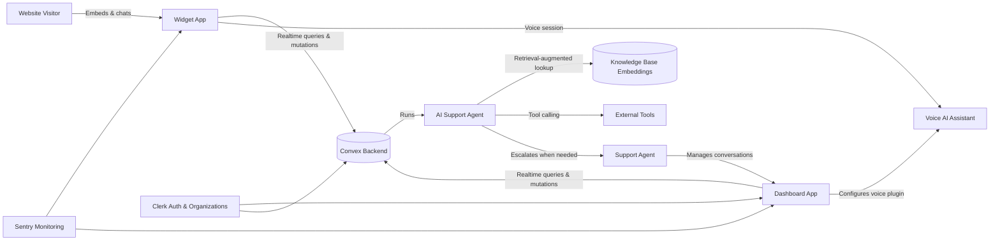

# Echo

> AI-powered customer support platform with an embeddable chat widget, an autonomous AI support agent, and a multi-tenant dashboard for support teams.


Echo is a full-stack support platform built as a Turborepo monorepo. It ships two customer-facing Next.js applications — an embeddable chat **widget** that any website can install, and a **dashboard** where support teams manage conversations — backed by a shared realtime Convex backend that powers an AI agent capable of answering from a knowledge base, calling tools, and escalating to a human when needed.

## Features

- **Embeddable chat widget** — a lightweight, themeable widget that can be dropped into any website to start conversations with visitors.
- **Autonomous AI support agent** — powered by an LLM agent framework, the agent answers visitor questions automatically, can call tools, and escalates conversations to a human agent when it can't resolve them.
- **Knowledge base with semantic search** — support teams upload files that are chunked and embedded, giving the AI agent retrieval-augmented answers grounded in the organization's own content.
- **Voice assistant** — visitors can start a live voice conversation with the AI agent directly from the widget.
- **Realtime conversations & inbox** — messages, presence, and conversation status (unresolved / escalated / resolved) sync instantly between the widget and the support dashboard.
- **Multi-tenant organizations** — every account, conversation, and knowledge base is scoped to an organization, so the platform can serve multiple customers independently.
- **Widget customization** — organizations can configure the widget's look, feel, and behavior per brand.
- **Billing** — subscription and plan management for organizations.
- **Integrations** — install snippets and connections for embedding the widget on external sites.
- **Error tracking** — application errors and performance are monitored in production.

## Tech stack

| Layer | Technology |
|---|---|
| Framework | Next.js 15 (App Router), React 19, TypeScript |
| Monorepo tooling | Turborepo, pnpm workspaces |
| Backend / database | Convex (realtime functions, storage & database) |
| AI | LLM agent framework with tool calling, RAG over embedded knowledge base documents |
| Voice AI | Vapi voice assistant integration |
| Auth & multi-tenancy | Clerk (authentication & organizations) |
| UI | shadcn/ui, Radix UI primitives, Tailwind CSS |
| State & forms | Jotai, React Hook Form, Zod |
| Monitoring | Sentry |
| Shared packages | Internal UI library, math/utility helpers, shared ESLint & TypeScript configs |

## Architecture & flow



1. A visitor opens the widget embedded on an organization's website and starts a conversation.
2. The widget talks to the shared Convex backend in realtime to create a contact session and persist messages.
3. The AI support agent picks up the conversation, optionally retrieving answers from the organization's embedded knowledge base and calling tools as needed.
4. If the agent can't resolve the request, the conversation is escalated and shows up live in the support dashboard's inbox.
5. Support agents authenticate through Clerk (scoped to their organization) and respond, customize the widget, manage billing, and review integrations from the dashboard.
6. Visitors can optionally switch to a live voice conversation with the AI agent through the voice assistant integration.

## Project structure

```
nextjs-echo/
├── apps/
│   ├── web/                     # Support dashboard (Next.js)
│   │   ├── app/
│   │   │   ├── (auth)/          # Sign in / sign up routes
│   │   │   └── (dashboard)/
│   │   │       ├── billing/
│   │   │       ├── conversations/
│   │   │       ├── customization/
│   │   │       ├── files/       # Knowledge base uploads
│   │   │       ├── integrations/
│   │   │       └── plugins/vapi/
│   │   └── modules/             # Feature modules (auth, dashboard, files)
│   └── widget/                  # Embeddable chat widget (Next.js)
│       ├── app/
│       └── modules/widget/
├── packages/
│   ├── backend/                 # Convex functions & schema
│   │   └── convex/
│   │       ├── public/          # Client-callable functions
│   │       ├── private/         # Dashboard-only functions
│   │       └── system/          # Internal/system functions
│   ├── ui/                      # Shared shadcn/ui component library
│   ├── math/                    # Shared utility helpers
│   ├── eslint-config/           # Shared lint rules
│   └── typescript-config/       # Shared TypeScript configs
└── turbo.json
```

## Data model (simplified)

- **conversations** — thread reference, organization, linked contact session, and status (`unresolved` / `escalated` / `resolved`).
- **contactSessions** — visitor identity (name, email), organization, expiry, and device/browser metadata captured from the widget.
- **users** — platform user record.
- **organizations** — managed by the auth provider; every conversation, session, and knowledge base document is scoped to one.

## Available scripts

| Command | Description |
|---|---|
| `pnpm dev` | Run all apps in development mode via Turborepo |
| `pnpm build` | Build all apps and packages |
| `pnpm lint` | Lint all apps and packages |
| `pnpm format` | Format the codebase with Prettier |

